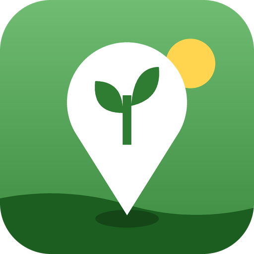
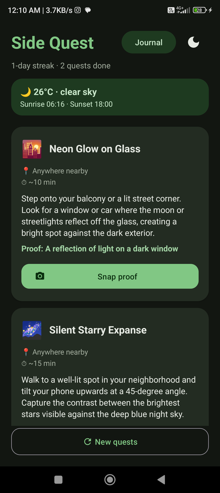

<p align="center">
  
</p>

<h1 align="center">Side Quest</h1>

<p align="center">
  <b>Small outdoor adventures, written from the real places around you.</b><br/>
  Get a quest. Put the phone away. Go outside. Prove it with one photo.
</p>

<p align="center">
  Built for the DEV <b>Hacktoberfest 2026 Open-Source AI Challenge, Week 1: "Touch Grass"</b>
</p>

---

## What it is

Most "go outside" apps are another screen to stare at. Side Quest tries to be the shortest
part of your walk.

Open it and it writes **three short real-world quests** from the parks, lakes, gardens and
viewpoints actually within walking distance, shaped by today's weather and how close sunset is:

> 🍂 **The first yellow leaf.** Walk to Lodhi Gardens (600 m north-west) and find a leaf that has started turning gold.
> 🌅 **Catch the last light.** Sunset is at 18:02. Catch it from the open lawn by the lake.
> 🐦 **Perched park watcher.** Find a bird sitting still on a branch or a wire.

Then the phone goes back in your pocket. When you find the thing, you snap one photo, an
**open-weight vision model** checks it, and the quest lands in your field journal.

<p align="center">
  
</p>

## How a quest works

```
 Open app ─▶ location ─▶ 3 quests from real nearby places  (≈30 s of screen time)
                                │
                                ▼
                     walk there, phone in pocket
                                │
                                ▼
 Snap proof ─▶ 📍 GPS: are you really there? ─▶ 📷 live camera photo ─▶ 🤖 AI: right thing?
                                                                              │
                                                       ✅ quest complete ◀────┘
                                                       field journal + 🔥 day streak
```

### You can't fake a Side Quest
Proof has three independent layers:

| Layer | Question it answers | How |
|---|---|---|
| 📍 **GPS geofence** | Are you actually *at* the place? | A fresh GPS fix must be within 400 m of a park/lake (150 m of a fountain or viewpoint), plus the reported GPS error, capped at 100 m. Too far → "You're 1.2 km away", with a Directions button. |
| 📷 **Live camera only** | Was the photo taken *now*? | Proof opens the camera directly; there's no gallery upload in release builds. |
| 🤖 **Vision referee** | Does it show *the right thing*? | Qwen looks at the photo against the quest's proof. Photos of screens or monitors are rejected. |

### Safety is enforced in code, not just prompts
- **After dark, the model is never shown parks or gardens at all.** They're often closed and unlit. Asking the model to avoid them in the prompt wasn't reliable (it still suggested a park at 3 AM in testing), so the backend simply drops all places after sunset. Night quests stay on the doorstep, balcony or a lit street.
- **Sunrise and sunset are computed on the server** (NOAA algorithm, within about 1 minute of Open-Meteo across five test cities), so day/night is known even if every weather service is down.
- Quests never ask anyone to trespass, climb, touch wildlife or enter water. In rain, they stay close to home.

## Open source at the core

Every piece Side Quest depends on is open:

| Piece | What it does | Why open matters here |
|---|---|---|
| **Qwen 3.8 27B** (open-weight, text + vision) | Writes the quests and referees the photo proof | The backend talks to *any* OpenAI-compatible endpoint. Moving from Qwen on Groq to Gemma on Hugging Face, or to a local Ollama server, is three environment variables, not a rewrite. |
| **OpenStreetMap** (Overpass API) | Real parks, water, gardens and viewpoints nearby | Community-mapped data with no paid maps API. It's what makes quests point at *your* neighbourhood. |
| **Open-Meteo** (open-source weather) | Current conditions | Free, no API key |
| **MET Norway** (open data) | Weather backup | Shared cloud IPs sometimes hit Open-Meteo's free limit; open data from a second provider keeps the weather working. |

The whole stack runs on free tiers. The free tiers shaped the design: Groq's 8,000
tokens/minute limit (a photo is about 1,800 tokens) led to automatic wait-and-retry, and slow
public map servers led to racing four Overpass mirrors and caching places for a day.

## Architecture

```
Android app (Kotlin + XML views)
  │  HTTPS + X-App-Key
  ▼
FastAPI backend (Python, Render free tier)
  ├── Overpass API (4 mirrors raced, 24 h cache) ─▶ nearby places
  ├── Open-Meteo → MET Norway fallback          ─▶ conditions + temperature
  ├── NOAA sun calculation (local)               ─▶ sunrise, sunset, day/night
  └── Qwen 3.8 27B via Groq                      ─▶ quests (JSON) + photo verdicts
```

- **The phone does no AI work.** It's a normal app; the backend holds the model key.
- **An app key** (`X-App-Key`) keeps strangers who find the public URL from spending the free model quota.
- **Your exact coordinates never reach the model.** It only sees place names, distances and the weather.

## Features

- 🗺️ Three quests per day from real nearby places, with **Directions** to any maps app
- 📍 GPS proof-of-presence, including asking to upgrade "approximate" to precise location on Android 12+
- 🤖 Photo referee with friendly, specific feedback, and a retry hint when a photo doesn't match
- 📔 Field journal of completed quests with your photos, plus a 🔥 day streak
- 🌙 Dark mode (icon toggle, remembered between launches)
- 🌧️ Weather-, sunset- and night-aware quests
- 💾 Today's quests are saved on the phone, so reopening the app doesn't spend another request

## Run it yourself

### 1. Backend

```bash
cd backend
python -m venv .venv
.venv\Scripts\activate            # macOS/Linux: source .venv/bin/activate
pip install -r requirements.txt
copy .env.example .env            # macOS/Linux: cp .env.example .env
uvicorn main:app --reload --port 8000
```

Fill in `backend/.env`:

| Variable | Example | Notes |
|---|---|---|
| `LLM_BASE_URL` | `https://api.groq.com/openai/v1` | Any OpenAI-compatible endpoint |
| `LLM_API_KEY` | `gsk_…` | Free key at https://console.groq.com/keys |
| `LLM_MODEL` | `qwen/qwen3.8-27b` | Must accept images (photo checking) |
| `APP_KEY` | any random string | Same value goes in the Android app; leave empty to disable locally |

**Deploy to Render:** push the repo, choose **New → Blueprint**, pick the repo (it reads
`render.yaml`), and set `LLM_API_KEY` and `APP_KEY` when asked. The free instance sleeps when
idle; the first request after that takes about 50 s, which the app's timeouts allow for.

### 2. Android app

Requirements: a recent Android Studio, JDK 21+, Android SDK 37.

1. Open the **`android/`** folder in Android Studio (not the repo root).
2. In `android/local.properties` (never committed) add the same key as the backend:
   ```properties
   APP_KEY=your-app-key
   ```
3. In `android/gradle.properties`, point `BACKEND_URL` at your backend:
   - deployed: `https://<your-service>.onrender.com/`
   - backend on your PC with a phone over USB: `http://localhost:8000/`, then run `adb reverse tcp:8000 tcp:8000`
4. Run on a phone, then go outside.

> Debug builds have one testing shortcut: **long-press "Snap proof"** to pick a gallery photo
> instead of the camera (it skips the GPS check). It doesn't exist in release builds.

### API

| Method | Path | Body | Returns |
|---|---|---|---|
| `GET` | `/` | | Health check and the active model (open, no key) |
| `POST` | `/quests` | `{lat, lon, tz_offset_min, count?, radius_m?}` | Weather, sunrise/sunset and 3 quests |
| `POST` | `/verify` | multipart: `photo`, `title`, `proof` | `{success, caption, message}` |

`/quests` and `/verify` require the `X-App-Key` header when `APP_KEY` is set.

## Project structure

```
backend/
  main.py              FastAPI app: places, weather, sun, quests, photo referee
  requirements.txt
  .env.example
android/app/src/main/java/com/example/sidequest/
  MainActivity.kt      Main screen: permissions, quests, proof flow, theme toggle
  JournalActivity.kt   Grid of completed quests
  QuestAdapter.kt      Quest cards (RecyclerView)
  ApiClient.kt         OkHttp + Gson, adds X-App-Key to every request
  LocationHelper.kt    Network/GPS fixes as suspend functions (no Play Services)
  Geofence.kt          "Are you close enough?" — distance + GPS accuracy
  Photos.kt            Camera file handoff (FileProvider), resize + EXIF rotation
  QuestStore.kt        Today's quests, journal, streak, dark mode (SharedPreferences)
  Models.kt            Data classes shared with the backend
render.yaml            Render blueprint
```

## Known limitations

- **Public map servers can be slow.** If no Overpass mirror answers within 15 s, you still get quests, but ones that work "anywhere nearby". The next request uses the cached places.
- **Free model limits.** About 3–4 photo checks per minute run at full speed; beyond that the backend waits and retries automatically.
- **GPS indoors** can take a while or fail. The app says so and asks you to step outside.
- **Opening hours aren't checked yet.** Daytime quests may point at a park that's closed for maintenance.

## Credits and data licences

- Map data © [OpenStreetMap](https://www.openstreetmap.org/copyright) contributors, available under the ODbL.
- Weather data by [Open-Meteo](https://open-meteo.com/) (CC BY 4.0) and [MET Norway](https://api.met.no/) (NLOD 2.0 / CC BY 4.0).
- Quest writing and photo checks by Qwen, an open-weight model, served by Groq.
- Icons: Material Design icons (Apache 2.0). The app icon is generated from the project's own geometry.

## License

[MIT](LICENSE)
